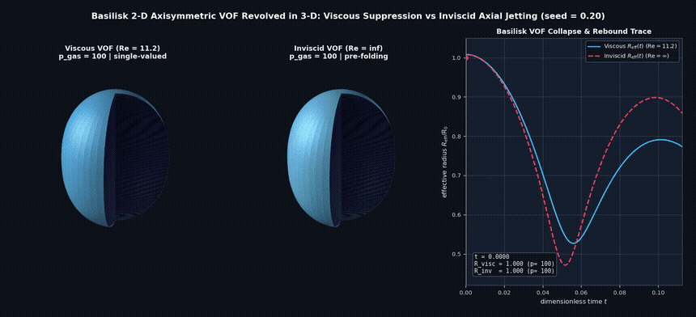
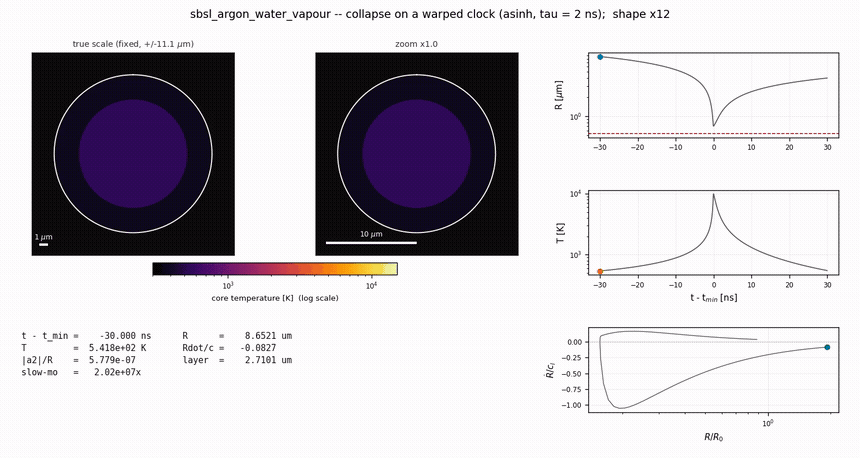
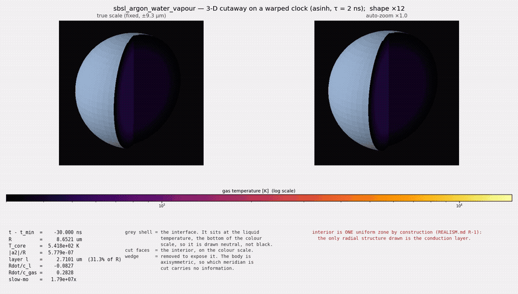
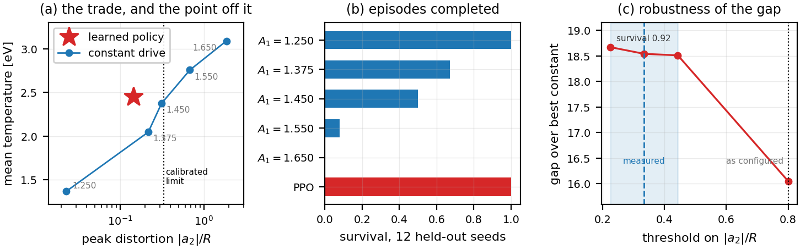
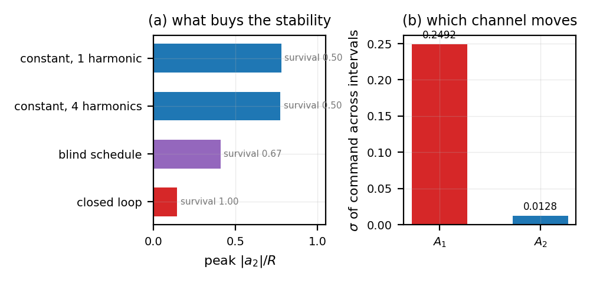
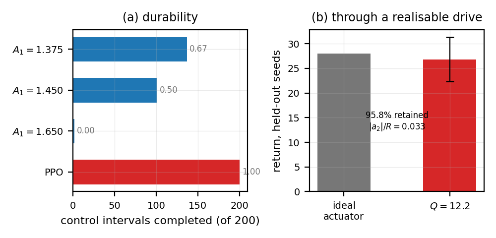
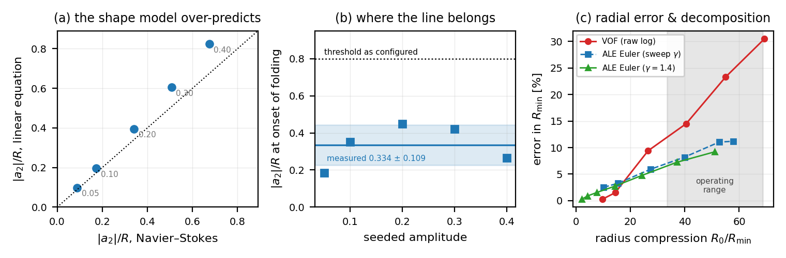
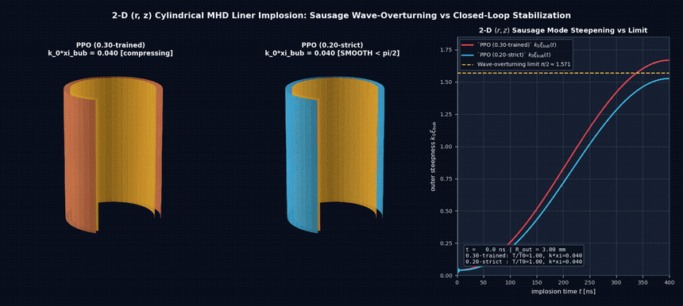

# Active Closed-Loop Suppression of Hydrodynamic & Plasma Instabilities

**Author:** Timur Shakurov ([shakurtimur@gmail.com](mailto:shakurtimur@gmail.com))  
**Status:** Research & Benchmark Preview

**Repository Contents:** This public repository contains the core differentiable physics modules (`core/gilmore.py`, `core/keller_miksis.py`, `core/plasma_core.py`, `core/interior.py`) and the Navier–Stokes CFD cross-validation scripts (`scripts/`). The closed-loop RL control environments (`envs/`), piezo-actuator lag models, and trained policy weights are held in a private repository pending provisional patent filing (full 15-page manuscript attached to the fellowship application / available upon request).

---

## 1. Overview

In high-energy-density physics (from single-bubble sonoluminescence (SBSL) to magneto-inertial fusion), compression fails before reaching its peak due to the Rayleigh–Taylor shape instability, which develops on a nanosecond time scale and breaks symmetry. This prevents stable plasma confinement without massive driver energy and cost. However, this ceiling applies to stationary forcing with constant amplitude, where core heating and boundary distortion are locked in the same monotonic trade-off.

This project builds a differentiable multiscale physics engine in JAX and trains closed-loop reinforcement learning (PPO) controllers that actively suppress interface instability cycle after cycle—sustaining a **2.45 eV (~28,400 K)** plasma core for **2,400 consecutive collapses** with **100% survival** at distortion levels where constant drives fragment, while maintaining **95.8% performance** through a physically feasible low-$Q$, high-voltage actuator ($Q = 12.2$, $2.6\text{ kV}$).

  

*Figure A: 3-D revolution of our independent axisymmetric compressible VOF audit of the Navier–Stokes equations in Basilisk (`seed = 0.20`), comparing viscous suppression (`single-valued`) with inviscid axial microjet motion and interface folding (`JET PIERCE / FOLDED`, calibrating the physical breakup threshold at `|a_2|/R = 0.334 ± 0.109`).*

---

## 2. Differentiable Single-Bubble Plasma Simulator (JAX)

To resolve the picosecond turnaround dynamics within a 37.7 µs acoustic period without losing gradient information, the simulator integrates a coupled 9-state ODE/PDE system in `float64` on an $\mathrm{asinh}$-warped clock ($\tau = 2\text{ ns}$):
- **Compressible fluid closures:** Keller–Miksis and Gilmore–Kirkwood–Bethe equations with the Tait fluid equation of state and exact analytical Jacobians.
- **Non-ideal reacting plasma core:** Saha ionization ladder in logarithmic space, diatomic dissociation, truncated vibrational partition functions, van der Waals hard-core excluded volume ($R_0/h \approx 8.86$), Toegel–Lohse thermal boundary layer, flux-limited Spitzer–Härm electron conductivity, optical escape factors, and dynamic interfacial water vapor transport.
- **Interface dynamics:** Coupled Plesset–Prosperetti quadrupole shape mode ($l=2$) seeded by thermal capillary waves.

  
  

*Figure B: Dynamics of the collapse over one cycle (`sbsl_argon_water_vapour`) on a clock with $\mathrm{asinh}$-warping ($\tau = 2\text{ ns}$). Left panel: 2-D cross-section showing core plasma heating to $1.9\times 10^4\text{ K}$, a thin Toegel–Lohse conduction boundary layer (`layer ≈ 0.08 µm`), and the $(R/R_0, \dot{R}/c_l)$ phase portrait. Right panel: 3-D cutaway with a 12-fold magnification of the $l=2$ quadrupole deformation.*

---

## 3. Closed-Loop RL Control Results

### Overcoming the steady-state trade-off between temperature and distortion
Evaluation across 12 held-out realizations of thermal capillary noise at horizons of 40 and 200 cycles (2,400 collapse cycles) shows that the learned PPO policy steps off the steady-state baseline curve:

| Control mode | Survival rate | Episodic Return | Average Peak $T$ [eV] | Peak Distortion $\Vert{}a_2\Vert{}/R$ |
| :--- | :---: | :---: | :---: | :---: |
| Constant $A_1 = 1.250\text{ atm}$ | 1.00 | $-0.51 \pm 1.10$ | 1.368 | 0.023 |
| Constant $A_1 = 1.375\text{ atm}$ | 0.67 | $+9.47 \pm 15.81$ | 2.046 | 0.218 |
| Constant $A_1 = 1.450\text{ atm}$ | 0.50 | $+8.07 \pm 20.74$ | 2.375 | 0.314 |
| Constant $A_1 = 1.550\text{ atm}$ | 0.08 | $-7.96 \pm 13.83$ | 2.757 | 0.683 |
| Constant $A_1 = 1.650\text{ atm}$ | 0.00 | $-12.13 \pm 0.65$ | 3.090 | 1.861 |
| **Closed-Loop PPO (ours)** | **1.00** | **$+28.01 \pm 4.15$** | **2.449** | **0.144** |

  

### Mechanism Ablation and Realizable Actuator Bandwidth ($Q = 12.2$)
- **Feedback vs. Waveform Shaping:** A static 4-harmonic waveform fixed at the average policy commands yields $\vert{}a_2\vert{}/R = 0.774$ (survival 0.50), identical to the 1-harmonic drive ($0.780$). Reproducing the open-loop policy schedule on a different noise seed achieves $0.409$ (survival 0.67). Only closed-loop state feedback achieves **0.144** with **survival of 1.00**, modulating the amplitude of the fundamental frequency ($\sigma(A_1) = 0.2492\text{ atm}$) while keeping higher harmonics nearly unchanged.
- **Durability over 2,400 collapses and hardware latency:** Over 200 control intervals (2,400 collapses), the policy completes 100% of episodes ($+151.56 \pm 22.18$ return at $2.53\text{ eV}$). Decomposition of the action trace shows that per-cycle modulation requires a broadband transducer with **$Q = 12.2$** ($2.6\text{ kV}$ drive) rather than a resonant flask with $Q = 1500$; when retrained with a first-order complex phasor lag in the control loop, the controller retains **95.8% of its return** at $\vert{}a_2\vert{}/R = 0.033$.

  
  

---

## 4. Validation Against Multi-Solver PDEs (Basilisk VOF, 1-D ALE Euler, and 2-D Multimode Potential)

To ensure that the RL policy exploits real fluid dynamics and not ODE closure artifacts, we cross-validated the model using three higher-fidelity PDE/marker solvers:
1. **2-D Axisymmetric Compressible Navier–Stokes VOF (Basilisk):** We confirmed that one-way shape-to-volume coupling holds within $\Delta R / R \approx 0.047(a_2/R)^2$ (<0.1% at the policy operating point), showed that linear Plesset–Prosperetti theory overestimates distortion prior to folding, and calibrated the inviscid folding threshold at $\vert{}a_2\vert{}/R = 0.334 \pm 0.109$.
2. **2-D Nonlinear Multimode Harmonic Potential ($l=2\dots 12$ Clebsch–Gordan):** Confirmed that the linear folding threshold remains scale-invariant ($0.349 \pm 0.014$) across compression ratios up to $C = R_0 / R_{\min} = 50.4$.
3. **1-D Spherical ALE Euler Solver with Boundary Fitting (350 shells):** Decomposed the apparent 30.5% radial VOF offset under deep compression ($C = 69.3$), showing that two-thirds comes from 6-decimal volume-log rounding (7.6%) and Eulerian VOF cell starvation (11.7%), leaving a physical Gilmore radiative damping residual of +7.5% to +9.2% for a realistic $\gamma \in [1.4, 5/3]$.

  

---

## 5. Generalization to Magneto-Inertial Fusion (Control of a Cylindrical MHD Liner)

To verify that the same closed-loop methodology generalizes beyond acoustic cavitation, the framework also implements a **1-D/2-D cylindrical Lagrangian MHD solver** (`core/liner.py`, `core/mrt.py`) for the implosion of a magnetized liner (MagLIF geometry) subject to the $m=0$ ("sausage") magneto-Rayleigh–Taylor instability on the outer current-driven surface, where azimuthal drive fields provide zero tension ($\mathbf{k}\cdot\mathbf{B}_\theta = 0$).

  

*Figure C: Closed-loop PPO pulse shaping during the implosion of a cylindrical MHD liner, suppressing the overturning of the $m=0$ sausage wave (`SMOOTH < pi/2` under strict shaping compared to `OVERTURNED > pi/2` under standard driving).*

---

## Verification & Contact

* **Test Suite:** analytical anchor tests (Rayleigh collapse, Lamb frequencies, Saha limits, Rankine–Hugoniot shock conditions, magnetic flux conservation, and bit-identical scalar/batched RL environment checks to $4\times 10^{-15}$).
* **Contact:** For access to the private codebase, full 15-page manuscript, or hardware testbed collaboration, reach out at **[shakurtimur@gmail.com](mailto:shakurtimur@gmail.com)**.
